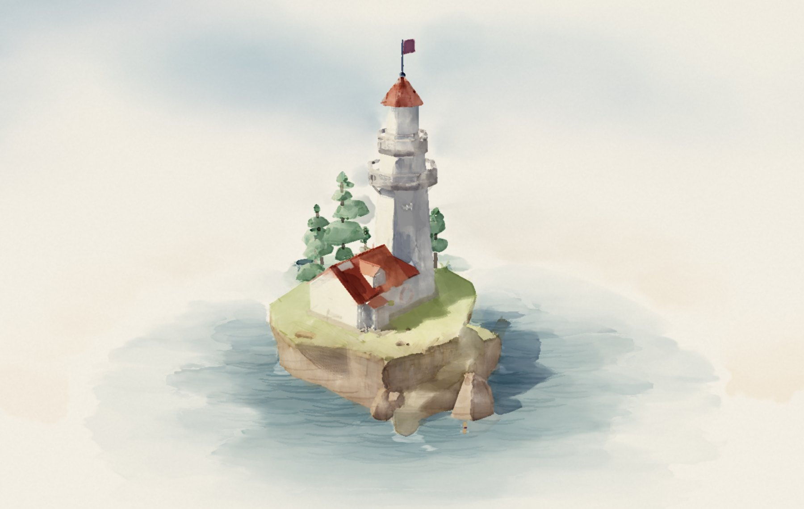

# 3D paintings

3D models painted live with brush strokes, repainted stroke by stroke as you turn them. Drag to turn, pinch to zoom:
https://erezu1.github.io/watercolor/

Each painting has its own address, e.g. https://erezu1.github.io/watercolor/#lighthouse or #moomin-house.

This repository holds only the published site: `index.html` (the page), `assets/` (each painting's model, fetched when
it is first shown, and the phone test), `frames/` (pre-painted views for browsers that cannot run the live painting) and
`preview.jpg` (the picture shown when the link is shared). The code that makes them is kept elsewhere.

## Credits and licenses
- **Dutch windmill** by Holywood (https://sketchfab.com/3d-models/dutch-windmill-45c2c76d8fb94f1cbdda4329cd7aeabf),
  licensed CC BY 4.0 (https://creativecommons.org/licenses/by/4.0/). Converted for this page, with grass added around it.
- **Windmill (game ready)** by LamedeFeu (https://sketchfab.com/3d-models/windmill-game-ready-6a006afce57a447baa60c7a6791f0086),
  licensed CC BY-NC-SA 4.0 (https://creativecommons.org/licenses/by-nc-sa/4.0/). Converted for this page, with grass added
  around it; the converted model is shared under the same license. Non-commercial use only.
- **Low-poly Lighthouse** by Murriarty (https://sketchfab.com/3d-models/low-poly-lighthouse-1a3a243e153343eeb50cadca536b4e59),
  licensed CC BY 4.0 (https://creativecommons.org/licenses/by/4.0/). Converted for this page.
- **Moomin House** by Kuutti Siitonen (https://sketchfab.com/3d-models/moomin-house-f262979495b943e2b28bc7a8a72c7cd4),
  licensed CC BY 4.0 (https://creativecommons.org/licenses/by/4.0/). Converted for this page (geometry simplified, small texture).
- **Japanese Bridge Garden** by kristenlee (https://sketchfab.com/3d-models/japanese-bridge-garden-d122e17593eb4012913cde927486d15a),
  licensed CC BY 4.0 (https://creativecommons.org/licenses/by/4.0/). Converted for this page.
- **Floating Castle** by Shahriar Shahrabi (https://sketchfab.com/3d-models/floating-castle-1e157bab3a4042eb834ca07d73aa28ce),
  licensed CC BY 4.0 (https://creativecommons.org/licenses/by/4.0/). Converted for this page (geometry simplified, colors
  read from its texture, clouds made plain white; sky, birds, the flying machine, effects and outlines removed).
- **Medieval castle with village** by Artbake Graphics (https://sketchfab.com/3d-models/medieval-castle-with-village-5109b5e46e064790badecedf8f6d2ef6),
  licensed CC BY 4.0 (https://creativecommons.org/licenses/by/4.0/). Converted for this page (the castle and its hill only;
  the village, forests and rock spires left out; walls recolored).
- **Chonky Cat Trio** by Kanna-Nakajima (https://sketchfab.com/3d-models/chonky-cat-trio-d9a2d94179384803af7456d633283496),
  licensed CC BY 4.0 (https://creativecommons.org/licenses/by/4.0/). Converted for this page (the base slab left out; grass
  ground added).
- **The Pavilion**: an original scene made for this page.
- three.js (MIT) is loaded from jsDelivr.
